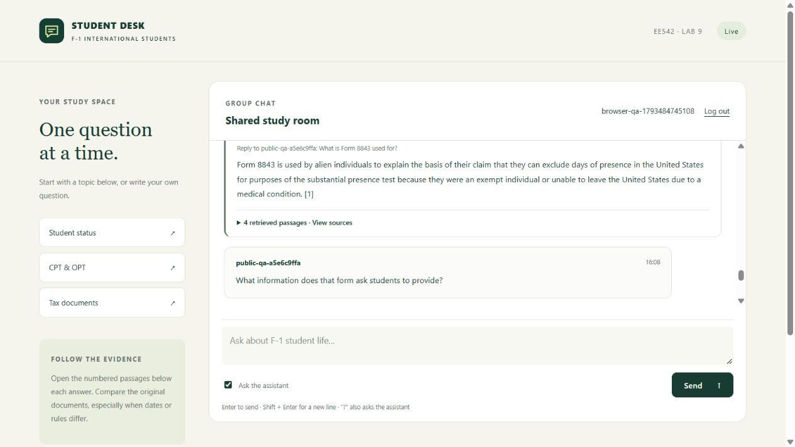

# EE 542 Laboratory Assignment 9

Part A: Website and System Integration

Instructor Part 1 + Part 4 website integration | October 31, 2026

## Scope and outcome

Part A connects the course group-chat website to the team's topic knowledge base and a self-hosted Llama model. The resulting F-1 Student Desk supports account access, real-time group chat, contextual questions, follow-ups, and inspectable sources. The website runs with MySQL on a Windows computer and is reachable through public HTTPS. The Android association file is published; final behavior on an installed signed APK remains a joint A/B verification task.

| Responsibility | Boundary |
| --- | --- |
| A: this report | MySQL/FastAPI website, Llama service, RAG integration, source display, deployment, and web-side Android association. |
| C: supplied dependency | Document ingestion, curated source snapshots, chunks, OpenAI vector index, retrieval interface, and evaluation questions. |
| B: separate contribution | Android TWA build/signing and Part 5 custom word-histogram embeddings. These are not claimed as A's implementation. |

## System overview

Browser (REST/WSS) -> FastAPI (A) -> retrieval (C: OpenAI + FAISS) -> local Llama. FastAPI stores messages and source snapshots in MySQL and broadcasts the result.

## Verified local environment

| Component | Configuration |
| --- | --- |
| Application | Windows; Python 3.12.14; MySQL Community Server 8.4.13; one Uvicorn worker. |
| Generation | Llama 3.1 8B Instruct, Q4_K_M; official llama.cpp b12023 CUDA server on an RTX 5070 Ti. |
| Separate source build | llama.cpp b12023 CPU server compiled with LLVM-MinGW, CMake, and Ninja; real response recorded. |

Repository: github.com/WenxuZhang-621/EE542-Lab9. Public site: https://desktop-jdferfe.taile24d30.ts.net/. The site depends on the host computer remaining online.

# 1. Request flow and RAG integration

## From a chat message to a sourced answer

The browser authenticates with REST endpoints and receives broadcasts over an authenticated WebSocket. Ordinary messages are stored and shared without invoking the model. A question mark or the explicit Ask the assistant control triggers ask_llm() in webapp/backend/app.py, which calls answer_with_sources() in rag_service.py. [1]

For follow-ups, the service uses the preceding conversation to resolve references such as "that form". The rewrite prompt requests the smallest possible edit and preserves the requested topic and language. Memory is isolated by user ID and browser-session UUID, retaining three turns in at most 256 sessions, with a one-hour idle expiry. It is process memory; it is not the persisted chat history.

C's synchronous rag.api.retrieve() embeds the question with OpenAI and searches the existing FAISS index. A runs retrieval through asyncio.to_thread(), allowing FastAPI's event loop to continue handling other connections. The source corpus and index are dependencies, not rebuilt by the website.

A expands each selected hit with immediate neighbors from the same source and page. This restores text cut by a chunk boundary while preserving the original hit ID and context chunk IDs. For an explicitly named form and category, at most half the source slots prioritize matching section headings; the other slots preserve semantic ranking.

The service sends numbered passages and the resolved question to the local Llama Chat Completions endpoint. It checks that citation numbers refer to supplied sources, marks cited sources, and returns the answer. This validates citation identifiers, not factual support. The OpenAI credential is used for embeddings only; model generation uses a separate local endpoint and credential.

## Actual contextual data and embedding example

C's fixed knowledge base contains 1,694 chunks from 17 sources. A's recorded trace uses the question "What is Form 8843 used for?" and the existing 1,536-dimensional text-embedding-3-small vectors. [2]

| Recorded item | Value / interpretation |
| --- | --- |
| Query coordinates 1-8 | 0.0109009, -0.0170417, 0.0110535, 0.0615150, -0.0066748, 0.0193760, -0.0330155, 0.0204592 |
| Normalized query norm | 1.0000001 (floating-point rounding). |
| First retrieved hit | irs-f8843.txt, page 3; cosine similarity 0.693199. |
| How it is used | FAISS inner product on unit-length vectors ranks passages; A adds context and supplies numbered excerpts to Llama. |

These eight coordinates are a sample of a learned 1,536-dimensional vector. They are not the K-dimensional word-cluster histogram developed separately by B.

# 2. Website behavior and engineering fixes

## Interaction and persistence

The frontend displays loading, completion, connection, and failure states. Users can retry a failed question. Source cards expose titles, publishers, page numbers, original URLs, and expandable excerpts. MySQL message_details stores the source snapshot alongside each answer, so refresh does not discard its evidence. Logout closes the WebSocket; login state is scoped to a browser tab.

The responsive layout was checked at a 390 x 844 viewport without horizontal overflow. The PWA service worker caches public static assets only. The public deployment requires an invitation for registration and applies request limits in the single website process. Only web port 8000 is forwarded publicly; database and model services remain local.

Figure 1. Recorded public HTTPS demonstration: a real question and follow-up with source cards. This is historical service evidence, not a simulated answer fixture. [3]



## Problems encountered and fixes

| Observed problem | A-side response |
| --- | --- |
| Truncated supporting text | Add same-page neighboring chunks to the prompt context without changing C's index. |
| Follow-up drift / wrong category | Use native chat roles, minimal reference rewriting, and explicit form/section matching. Add regression cases. |
| Embedding credit exhaustion | Return a specific insufficient-credit error and retry control; verify a real request after credits become available. |
| Windows build / deployment | Enable long Git paths and a Windows 10 compiler target for the CPU source build. Start IP Helper to resolve the Tailscale installation prerequisite. |

# 3. Validation results and limitations

## Verification evidence

| Check | Result and scope |
| --- | --- |
| Current A regression tests | 27 passed: web application, web/RAG integration, public access, and Asset Links tests. JavaScript syntax validation passed. |
| Current local preflight | Index integrity, JWT configuration, configured embedding key, MySQL connection, and Llama connectivity passed. This is not a paid embedding or credit check. |
| Earlier integration suite | 66 tests and five subtests passed, including C's real MySQL storage checks. This historical combined run is not an A-only test count. |
| Real end-to-end QA | Recorded OpenAI embeddings + C retrieval + local Llama + HTTP/WSS + MySQL. Two-client broadcasting and persisted-source readback passed. |
| Deployment / Android link | Recorded external HTTPS checks passed. Published Asset Links matches B's package and release certificate. Installed-APK TWA behavior remains pending. |
| Build alternatives | CPU source build generated a real answer; the daily server uses the official prebuilt CUDA binary. Compose configuration parsed successfully; Docker containers were not run locally. |

## Recorded 32-question evaluation

A ran C's fixed question set through the actual QA service, using a separate session for each question. The evaluation did not insert its 32 test answers into the shared room. The saved JSON includes questions, answers, selected passages, source identifiers, and timings. [4]

| Measure | Result |
| --- | --- |
| Returned answer / valid citation identifier | 32/32 for each measure |
| Selected or expanded context hit an annotated chunk | 30/32 |
| Cited context hit an annotated chunk | 28/32 |
| Median response time in this run | 0.963 seconds |

## What the results do not establish

Coverage and valid citation numbers are not answer-accuracy scores. Manual review found a wrong timing fact in question 3, unacknowledged source conflicts in questions 5 and 16, and missed annotated evidence in questions 12 and 27. Question 23 changed a time relationship in an unsupported way. The prompt alone did not reliably prevent these errors; the detailed cases remain in A-EVALUATION.md.

This course demonstration uses fixed source snapshots and is not validated for personal legal or tax decisions. Multi-worker deployment would require shared connection, session, and rate-limit infrastructure. Availability depends on the host and its services.

# 4. Reproduction and delivery status

## A-side reproduction

Use Python 3.12 or newer from the repository root. Create and activate a virtual environment, install A's requirements, and generate local configuration. setup_a creates .env only when absent and does not print generated credentials. [5]

```sh
python -m pip install -r requirements-a.txt
python -m scripts.setup_a
# Configure your own local .env and start MySQL/Llama.
python -X utf8 -m webapp.backend.run
```

The default setup targets MySQL on port 13306; the verified native deployment uses 13409 through its local .env. Configure the actual DSN, JWT secret, OpenAI embedding key, and local Llama endpoint. Do not commit these values. Model weights, databases, Python environments, and Android signing secrets are excluded from source delivery.

```sh
python -m scripts.check_setup
python -m scripts.check_setup --live
python -m scripts.smoke_web_live
python -m scripts.trace_embedding
python -m scripts.evaluate_a
```

Only the first command avoids paid model requests. The remaining commands call real embeddings and/or local Llama; smoke testing creates QA accounts and messages. For offline A regressions, install tests/requirements.txt and run the four test modules listed in webapp/README.md. For a source build and deployment options, follow DEPLOY-A.md.

## Web-side handoff and remaining joint check

A provides the public HTTPS URL and source-aware web interface. B supplied applicationId edu.usc.ee542.f1assistant and its release certificate SHA-256 fingerprint in commit 31e6928. A generated the matching /.well-known/assetlinks.json and verified its HTTPS response. The evidence is recorded in evidence/a/android-association.json. B must still validate the installed signed APK for address-bar-free launch, login, chat, questions, and source navigation.

A's initial implementation was merged through pull request #1. Its deliverables include webapp/, deployment and verification scripts, infra/, focused tests, A's technical documentation, and evidence/a/. C's source data, evaluation annotations, and original vector index retain their separate provenance. B's build and embedding results remain separate contributions.

## Repository references

[1] Request handling and integration: webapp/backend/app.py; webapp/backend/rag_service.py; webapp/frontend/app.js

[2] Actual embedding sample: evidence/a/embedding-trace.json

[3] Live website verification: evidence/a/live-web-smoke.json; evidence/a/public-https-smoke.json

[4] Evaluation and manual review: evidence/a/evaluation.json; docs/A-EVALUATION.md

[5] Setup, build, and handoff: webapp/README.md; docs/DEPLOY-A.md; docs/A-HANDOFF.md; docs/A-TO-B.md

Requirement mapping uses the supplied lab9-f26.pdf and the course portal's Laboratory Assignment 9. A covers Part 1 and the website integration in Part 4; the whole-team video and Android deliverables require the other members' contributions.
